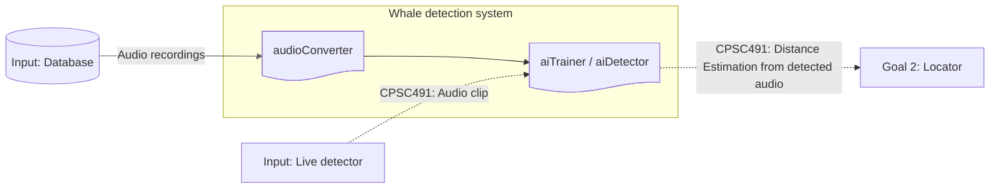
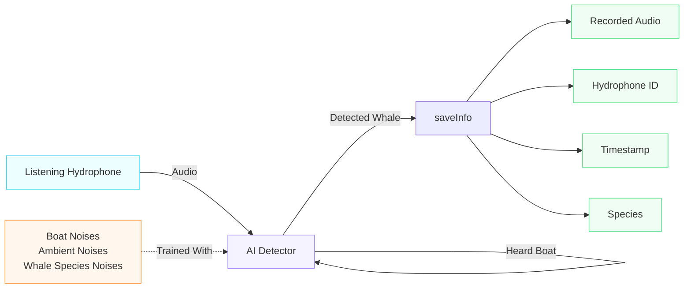

# Design - AI detection

> Epic: #8 · Stories: #10, #11, #12, #13
> Sprint: 3 · Status: draft
> Specification: [../specs/goal-1-detector.md] (need to connect when merged in same branch)

## 1. System Context

The system boundary for the detector exists in between the database and
locator. It first draws from the database to first train itself to sufficiency, and
later sends what it detectors to the locator.

*Figure 1- System Context. Solid rectangle shows what is in context for the detector. Solid lines show what has been designed in prototype, both in and out of context. Dotted lines show what will be implemented in CPSC 491.*

## 2. Components

| Component | Responsibility | Interface | Where |
|---|---|---|---|
| audioConverter | Converts the audio files stored in the database to a readable format for the detector (.npz) | Audio file -> `/data` | `prototype/ai-detector` |
| aiDetector | Builds/trains the models based off the files located within data. Can also be ran to detect the noises trained for. | `/data` -> model.pt | `prototype/ai-detector/whale_detector.py` |
| live detector | Runs the ai indefinitely, forwarding the recording, time, and hydrophone ID when hearing a whale | live audio -> `/recordings` | `prototype/ai-detector` |

## 3. Data Model

"""MODEL SHOWING THE TRAINING"""

*Figure 2- *

## 4. Data Flow (Level 1)

*Figure 3-*

## 5. Key Decisions

| Decision | Options Considered | Chosen | Why |
|---|---|---|---|
| AI Model(s) | Training one model with multiple whales · Training multiple models, one whale each | Multiple models | The frequency and length that whale calls are made at vary between species. Training on one model leads to the model being unsure of how to interpret the data as it sees the differences between them without understanding them. Using multiple allows them to specialize in detecting their given species. |
