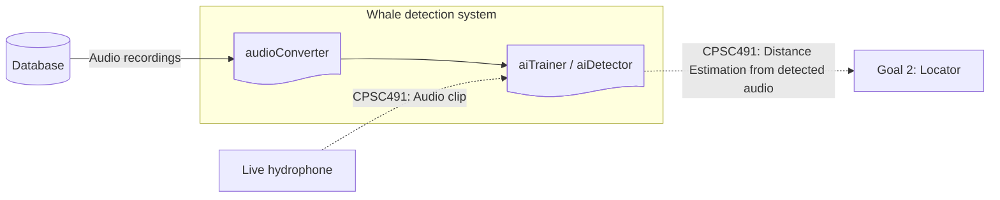
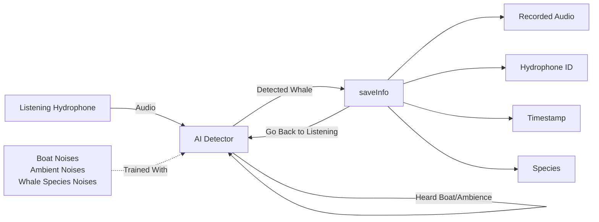

# Design - AI detection

> Epic: #8 · Stories: #10, #11, #12, #13
> Sprint: 3 · Status: draft
> Specification: [../specs/goal-1-detector.md] (need to connect when merged in same branch)

## 1. System Context

The system boundary for the detector exists in between the database and
locator. It first draws from the database to first train itself to sufficiency, and
later sends what it detectors to the locator.

*Figure 1- System Context. Solid rectangle shows what is in context for the detector. Solid lines show what has been designed in prototype, both in and out of context. Dotted lines show what will be implemented in CPSC 491.*

The detector takes inputs from two sources, our created database and hydrophone we're listening from. The database is what we use to train our AI, using the audio stored in it to teach the detector what a whale sounds like, as well as sounds of what to ignore (boat noises and ambient noises). The detector then takes in audio from the hydrophone that it's listening to. Once it hears a whale, it saves the necessary information, before sensing it to the locator.

## 2. Components

| Component | Responsibility | Interface | Where |
|---|---|---|---|
| audioConverter | Converts the audio files stored in the database to a readable format for the detector (.npz) | Audio file -> `/data` | `whale_converter.py` / `boat_converter.py` / `ambient_converter.py` |
| aiTrainer | Builds/trains the models based off the files located within data. | `/data` -> model.pt | `whale_detector.py` |
| aiDetector | Is the AI build by the trainer. Designed to run indefinitely, sending the recorded information upon hearing a whale. | live audio -> `/recordings` | `prototype/ai-detector` |

## 3. Data Model

Creating the AI requires having some amount of data be held in memory up until it is sufficiently trained. It starts with the raw audio that's stored in the database. It takes in any audio file type, before being converted into an npz file. The created npz files are then used to train the detector, which is then stored as a pt file.

| Data | Data Type | Produced By → Used By |
|---|---|---|
| Raw Audio | .mp3 / .ogg / .wav / .flac | Database → `audioConverter` |
| Training Audio | .npz | `audioConverter` → `aiTrainer` |
| Trained AI | .pt | `aiTrainer` → runs on `whale_detector.py` (Later: to run on a live hydrophone) |
| Saved Info | .wav | Trained AI → CPSC 491: Will send the recorded info to the locator |

The AI will still use memory even after being build, as it is designed to save the information of the sounds it hears.

## 4. Data Flow (Level 1)

*Figure 2- Diagram of how the detector reacts if it is hearing a noise.*

Figure 3 shows how the data flows within the detector. It starts with the detector being trained on the three noise class, with the Whale Species class being that of the noises made by the species we want to detect. After being trained to sufficiency, it is then connected to a live hydrophone to listen for any possible noises made. While listening, if it hears a boat or ambient noise, it simply goes back to listening without doing anything. If it hears a whale, it saves the necessary information for the locator/documentation. It saves a recording of the whale noise, the ID of the hydrophone that recorded it, when it was recorded, and what species made the call. Once saved, it goes back to listening for more noises.

## 5. Key Decisions

| Decision | Options Considered | Chosen | Why |
|---|---|---|---|
| AI Model(s) | Training one model with multiple whales · Training multiple models, one whale each | Multiple models | The frequency and length that whale calls are made at vary between species. Training on one model leads to the model being unsure of how to interpret the data as it sees the differences between them without understanding them. Using multiple allows them to specialize in detecting their given species. |

## 6. Not Designed Yet

- How the detector will signal to the locator that it has some audio to send it.
- How it would handle multiple whales calling at once, as it could make the be seen as longer than are trained for.
