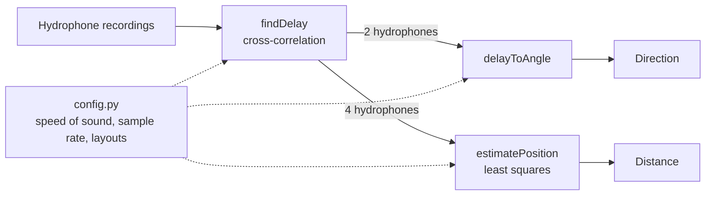

# Design — Goal 2: Locator

> Epic: #14 · Stories: #15, #16, #17, #18 · Task: #49
> Owner: Aylani Tran · Sprint: 3 · Status: ready for review · Spec: [goal-2-locator.md](../specs/goal-2-locator.md)

## 1. System context

*Figure 1. System context. Solid lines exist in the prototype; dashed lines are planned for CPSC 491.*

The locator takes audio recordings from a hydrophone array as input. For now, these recordings are generated by `simulate.py`, which simulates hydrophones by adding delays and noise to a test sound instead of using recordings from real hydrophones. The locator processes the recordings to estimate where a whale call came from, returning a direction when using two hydrophones and a distance when using four hydrophones arranged in a 50 m square. The AI detector (Goal 1) and the Postgres database sit outside the locator: the detector will identify which audio clips contain whale calls, and the database will store the locator’s results. Neither is connected yet; both connections are planned for CPSC 491 and are shown as dashed lines in Figure 1 ([epic:#14](https://github.com/M-Kwatcher/CPSC490-G05-Fighting-Mongooses/issues/14), [story:#15](https://github.com/M-Kwatcher/CPSC490-G05-Fighting-Mongooses/issues/15), [story:#16](https://github.com/M-Kwatcher/CPSC490-G05-Fighting-Mongooses/issues/16)).

## 2. Components

The locator is made up of four Python modules inside `prototype/locator/`. Each module handles a different part of the process, from setting up the recording parameters to generating simulated audio and calculating the location of a sound source.

| Component | Responsibility | Interface | Where |
|---|---|---|---|
| Settings | Stores the values needed for calculations, such as the speed of sound (1,500 m/s), sample rate (48 kHz), and hydrophone positions. | `SPEED_OF_SOUND`, `SAMPLE_RATE`, `HYDROPHONES`, `DISTANCE_HYDROPHONES` | `config.py` |
| Simulator | Creates fake hydrophone recordings from a test sound, adding delays and noise based on a known source location so results can be checked against the true answer. | `makeSound()`, `sourceAtAngle()`, `recordAtHydrophones()` | `simulate.py` |
| Direction | Finds the time difference between two recordings using cross-correlation and uses it to calculate the angle the sound came from. | `findDelay()`, `delayToAngle()`, `estimateAngle()` | `tdoa.py` |
| Distance | Uses the measured delays from four hydrophones to estimate the source's (x, y) position by finding the best fit between the measured and predicted delays, then its distance from the array center. | `estimatePosition()`, `estimateDistance()` | `locate.py` |

### Hydrophone layouts

The prototype uses two hydrophone layouts, both set in `config.py`. For direction, `HYDROPHONES` places two hydrophones 10 m apart. Two hydrophones give one delay, which is enough for an angle, but not enough for a distance, and they cannot tell whether the sound came from in front of or behind the pair, so angles are reported on the front side. For distance, `DISTANCE_HYDROPHONES` places four hydrophones at the corners of a 50 m square. Four hydrophones give three independent delays, which is enough to solve for an (x, y) position. With this layout the estimated distance stays within 10% of the true distance from 25 m to 500 m, in front of and behind the array, with noise ([story:#15](https://github.com/M-Kwatcher/CPSC490-G05-Fighting-Mongooses/issues/15), [story:#16](https://github.com/M-Kwatcher/CPSC490-G05-Fighting-Mongooses/issues/16)).

### The math

Both estimates start from the time difference of arrival (TDOA): a hydrophone farther from the whale hears the call slightly later. `findDelay()` measures that delay by cross-correlating two recordings and finding the shift where they line up best. At 48 kHz, one sample is 1/48,000 s, which is 3.125 cm of travel at 1,500 m/s, so the delay is measured to the nearest 3.125 cm.

For direction, the locator assumes a far-field source so the incoming sound wave can be approximated as a plane wave. 

Let:

- d = spacing between two hydrophones
- c = speed of sound in water
- Δt = measured time difference of arrival 
- θ = angle of arrival measured from the line perpendicular to the hydrophone pair 

The difference in travel distance between the hydrophones is:

ΔL = cΔt

From the geometry of the hydrophone pair: 

ΔL = d sin(θ)

Combining the equations: 

cΔt = d sin(θ)

Solving for θ:
$$\theta = \arcsin\left(\frac{c\,\Delta t}{d}\right)$$

A positive Δt means the sound reaches the first hydrophone before the second hydrophone. A negative Δt means the sound reaches the second hydrophone before the first. Positive and negative angles follow the same convention. 

The ratio is clipped to [-1,1] before applying arcsin so that noisy measurements cannot produce invalid angles. 

### Assumptions

Direction estimation relies on the following assumptions:
- The whale is far away compared to the hydrophone spacing.
- Sound travels in a straight line between the whale and hydrophones.
- The speed of sound remains constant at 1500 m/s.
- The incoming wavefront is approximately planar across the hydrophone pair.

These assumptions are appropriate for the simulator-based prototype but may introduce error when using real recordings. 

For distance, a candidate source position (x, y) predicts a delay for each hydrophone i relative to the first:

$$\Delta t_i = \frac{r_i - r_1}{c}$$

where rᵢ is the distance from (x, y) to hydrophone i. `estimatePosition()` uses least squares (`scipy.optimize.least_squares`) to find the (x, y) whose predicted delays best match the measured ones. It starts from 36 guesses around the array and keeps the best fit, so it does not get stuck in a wrong answer. `estimateDistance()` then returns the distance from the array center to that point ([story:#16](https://github.com/M-Kwatcher/CPSC490-G05-Fighting-Mongooses/issues/16)).

## 3. Data model

The locator does not store anything; it works on data held in memory and returns plain numbers. Every value uses SI units (meters, seconds) except angles, which are in degrees.

| Data | Shape | Units | Produced by → used by |
|---|---|---|---|
| Recording | 1-D NumPy array, one per hydrophone, all the same length | samples at 48 kHz | `recordAtHydrophones()` (later: real hydrophones) → `findDelay()` |
| Hydrophone positions | list of (x, y) tuples | meters | `config.py` → `delayToAngle()`, `estimatePosition()` |
| Delay | float (one per pair, or one per hydrophone after the first) | seconds | `findDelay()`, `measuredDelays()` → `delayToAngle()`, `estimatePosition()` |
| Direction | float, −90° to 90° | degrees | `delayToAngle()` → caller |
| Source position | (x, y) tuple | meters | `estimatePosition()` → `estimateDistance()` |
| Distance | float | meters | `estimateDistance()` → caller |

Saving a located call (its direction, distance and time) belongs to the shared Postgres database designed by the team for Goal 1's saved calls. Connecting the locator's output to it is planned for CPSC 491 (Figure 1).

## 4. Data flow

*Figure 2. Data flow through the locator.*

Figure 2 shows how a set of recordings becomes a location. Every path starts at `findDelay()`, which cross-correlates two recordings and returns how many seconds later the second one heard the sound. From there the flow splits by layout. With two hydrophones, the single delay goes to `delayToAngle()`, which returns the direction. With four hydrophones, `measuredDelays()` collects one delay per hydrophone after the first, and `estimatePosition()` fits the (x, y) whose predicted delays match them best; `estimateDistance()` turns that point into a distance from the array center. `config.py` feeds the speed of sound, sample rate and hydrophone positions into every step (dotted lines), so changing a constant there, such as the speed of sound for a different water temperature, changes every result in one place ([story:#15](https://github.com/M-Kwatcher/CPSC490-G05-Fighting-Mongooses/issues/15), [story:#16](https://github.com/M-Kwatcher/CPSC490-G05-Fighting-Mongooses/issues/16), [story:#18](https://github.com/M-Kwatcher/CPSC490-G05-Fighting-Mongooses/issues/18)).

## 5. Key decisions

Each decision below lists the options we considered and why we chose one. The numbers come from the prototype's tests.

| Decision | Options considered | Chosen | Why |
|---|---|---|---|
| How to measure the delay | Threshold onset (time when the signal first gets loud) vs. cross-correlation | Cross-correlation (`scipy.signal.correlate`) | Onset detection breaks when noise is loud; cross-correlation uses the whole call, and the direction tests stay within 15° with noise as loud as the call itself. |
| How to solve for position | Closed-form hyperbolic equations vs. least-squares fit | Least squares (`scipy.optimize.least_squares`) with 36 starting guesses | Closed-form solutions assume exact delays and become unstable with noise; least squares finds the best fit to noisy delays and works for any number of hydrophones. Multiple starting guesses keep it from settling on a wrong local answer. |
| Hydrophone layout for distance | 2 hydrophones; 3 hydrophones 10 m apart; 4 hydrophones in a 50 m square | 4 in a 50 m square | 2 cannot measure distance at all. 3 at 10 m stayed within 10% only out to about 50 m. 4 in a 50 m square stayed within 10% from 25 m to 500 m and passed 283 of 288 cases (98%) in a wider sweep. |
| Speed of sound | Speed in air (343 m/s); a depth/temperature profile; one constant for seawater | 1,500 m/s constant in `config.py` | Whales are recorded underwater, so air is wrong. A full sound-speed profile is more accurate but needs data we don't have yet; one constant is close enough for the prototype and can be changed in one place ([story:#18](https://github.com/M-Kwatcher/CPSC490-G05-Fighting-Mongooses/issues/18)). |
| Test data | Real hydrophone recordings vs. simulated recordings | Simulated (`simulate.py`) | We have no hydrophone array, and real recordings have no known true location. Simulation gives an exact answer to test against, at any angle, distance and noise level. |
| Geometry | 3-D (including depth) vs. 2-D | 2-D (x, y) | Depth would need hydrophones at different depths; 2-D proves the method first. |

## 6. Known limits and not designed yet

### Known limits

- **Front/back ambiguity with two hydrophones.** A pair cannot tell whether a sound came from in front or behind, so `delayToAngle()` always reports the front-side angle. The four-hydrophone layout does not have this problem.
- **Delay precision depends on the sample rate.** At 48 kHz one sample is 3.125 cm of travel, which is precise enough. The whale-call dataset we plan to use is sampled at 2 kHz, where one sample is 0.75 m. That makes direction and distance much less precise, especially for close hydrophones ([task:#50](https://github.com/M-Kwatcher/CPSC490-G05-Fighting-Mongooses/issues/50)).
- **Edge cases in the distance fit.** In the wider sweep, 5 of 288 cases (2%) missed the 10% target.
- **Simulated only.** Every result so far comes from simulated recordings with perfect timing between hydrophones. Real hydrophones will have clock drift and echoes that the simulation does not model.

### Not designed yet

- **Sub-sample delay estimation** (interpolating between samples) to recover precision at 2 kHz ([task:#50](https://github.com/M-Kwatcher/CPSC490-G05-Fighting-Mongooses/issues/50)).
- **Connection to the AI detector** (Goal 1), so the locator only runs on clips the detector marks as whale calls (CPSC 491).
- **Saving located calls** to the shared Postgres database (CPSC 491).
- **Depth (3-D) and a real sound-speed profile**, which need hydrophones at different depths and temperature data.
- **More than one whale calling at once**, which would need separating the calls before measuring delays.