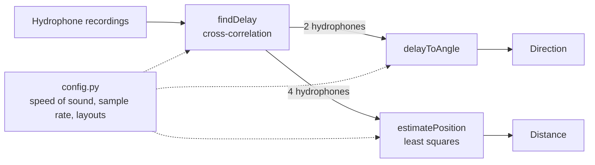

# Design — Goal 2: Locator

> Epic: #14 · Stories: #15, #16, #17, #18 · Task: #49
> Owner: Aylani Tran · Sprint: 3 · Status: draft · Spec: [goal-2-locator.md](../specs/goal-2-locator.md)

## Overview

## Data flow

*Figure 1. Data flow through the locator.*

## Hydrophone layouts

## The math

## Key decisions

## Known limits

## Not designed yet