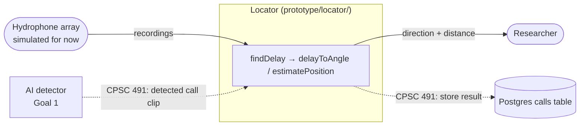
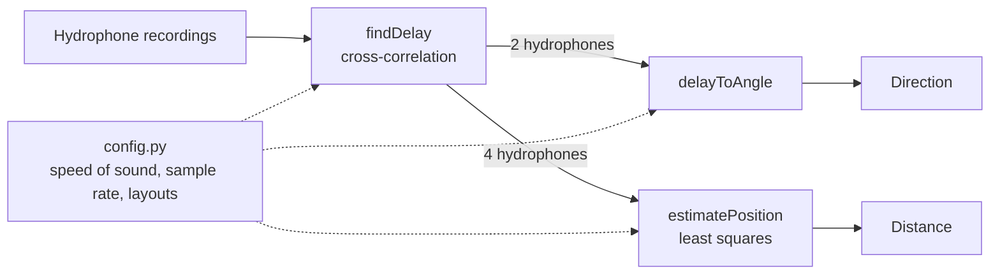

# Design — Goal 2: Locator

> Epic: #14 · Stories: #15, #16, #17, #18 · Task: #49
> Owner: Aylani Tran · Sprint: 3 · Status: draft · Spec: [goal-2-locator.md](../specs/goal-2-locator.md)

## 1. System context

*Figure 1. System context. Solid lines exist in the prototype; dashed lines are planned for CPSC 491.*

The locator takes audio recordings from a hydrophone array as input. For now, these recordings are generated by `simulate.py`, which simulates hydrophones by adding delays and noise to a test sound instead of using recordings from real hydrophones. The locator processes the recordings to estimate where a whale call came from, returning a direction when using two hydrophones and a distance when using four hydrophones arranged in a 50 m square. The AI detector (Goal 1) and the Postgres database sit outside the locator: the detector will identify which audio clips contain whale calls, and the database will store the locator’s results. Neither is connected yet; both connections are planned for CPSC 491 and are shown as dashed lines in Figure 1 ([epic:#14](https://github.com/M-Kwatcher/CPSC490-G05-Fighting-Mongooses/issues/14), [story:#15](https://github.com/M-Kwatcher/CPSC490-G05-Fighting-Mongooses/issues/15), [story:#16](https://github.com/M-Kwatcher/CPSC490-G05-Fighting-Mongooses/issues/16)).

## 2. Components
The locator is made up of four Python modules inside `prototype/locator/`. Each module handles a different part of the process, from setting up the recording parameters to generating simulated audio and calculating the location of a sound source.

| Component | Responsibility | Interface | Where |
|---|---|---|---|
| Settings | Stores the values needed for calculations, such as the speed of sound (1,500 m/s), sample rate (48 kHz), and hydrophone positions. | `SPEED_OF_SOUND`, `SAMPLE_RATE`, `HYDROPHONES`, `DISTANCE_HYDROPHONES` | `config.py` |
| Simulator | Creates fake hydrophone recordings from a test sound, adding delays and noise based on a known source location so results can be checked against the true answer. | `makeSound()`, `sourceAtAngle()`, `recordAtHydrophones()` | `simulate.py` |
| Direction | Finds the time difference between two recordings using cross-correlation and uses it to calculate the angle the sound came from. | `findDelay()`, `delayToAngle()`, `estimateAngle()` | `tdoa.py` |
| Distance | Uses the measured delays from four hydrophones to estimate the source's (x, y) position by finding the best fit between the measured and predicted delays, then its distance from the array center. | `estimatePosition()`, `estimateDistance()` | `locate.py` |

### Hydrophone layouts

The prototype uses two hydrophone layouts, both set in `config.py`. For direction, `HYDROPHONES` places two hydrophones 10 m apart. Two hydrophones give one delay, which is enough for an angle, but not enough for a distance, and they cannot tell whether the sound came from in front of or behind the pair, so angles are reported on the front side. For distance, `DISTANCE_HYDROPHONES` places four hydrophones at the corners of a 50 m square. Four hydrophones give three independent delays, which is enough to solve for an (x, y) position. With this layout the estimated distance stays within 10% of the true distance from 25 m to 500 m, in front of and behind the array, with noise ([story:#15](https://github.com/M-Kwatcher/CPSC490-G05-Fighting-Mongooses/issues/15), [story:#16](https://github.com/M-Kwatcher/CPSC490-G05-Fighting-Mongooses/issues/16)).

### The math

Both estimates start from the time difference of arrival (TDOA): a hydrophone farther from the whale hears the call slightly later. `findDelay()` measures that delay by cross-correlating two recordings and finding the shift where they line up best. At 48 kHz, one sample is 1/48,000 s, which is 3.125 cm of travel at 1,500 m/s, so the delay is measured to the nearest 3.125 cm.

For direction, if the delay is Δt and the hydrophones are d apart, the extra distance the sound traveled is c·Δt, so the angle is

$$\theta = \arcsin\left(\frac{c\,\Delta t}{d}\right)$$

where c = 1,500 m/s is the speed of sound in seawater ([story:#18](https://github.com/M-Kwatcher/CPSC490-G05-Fighting-Mongooses/issues/18)). The ratio is clipped to [−1, 1] before the arcsin so a noisy delay cannot produce an invalid angle.

For distance, a candidate source position (x, y) predicts a delay for each hydrophone i relative to the first:

$$\Delta t_i = \frac{r_i - r_1}{c}$$

where rᵢ is the distance from (x, y) to hydrophone i. `estimatePosition()` uses least squares (`scipy.optimize.least_squares`) to find the (x, y) whose predicted delays best match the measured ones. It starts from 36 guesses around the array and keeps the best fit, so it does not get stuck in a wrong answer. `estimateDistance()` then returns the distance from the array center to that point ([story:#16](https://github.com/M-Kwatcher/CPSC490-G05-Fighting-Mongooses/issues/16)).

## 3. Data model
The locator does not store anything; it works on data held in memory and returns plain numbers. Every value uses SI units (meters, seconds) except angles, which are in degrees.

| Data | Shape | Units | Produced by → used by |
|---|---|---|---|
| Recording | 1-D NumPy array, one per hydrophone, all the same length | samples at 48 kHz | `recordAtHydrophones()` (later: real hydrophones) → `findDelay()` |
| Hydrophone positions | list of (x, y) tuples | meters | `config.py` → `delayToAngle()`, `estimatePosition()` |
| Delay | float (one per pair, or one per hydrophone after the first) | seconds | `findDelay()`, `measuredDelays()` → `delayToAngle()`, `estimatePosition()` |
| Direction | float, −90° to 90° | degrees | `delayToAngle()` → caller |
| Source position | (x, y) tuple | meters | `estimatePosition()` → `estimateDistance()` |
| Distance | float | meters | `estimateDistance()` → caller |

Saving a located call (its direction, distance and time) belongs to the shared Postgres database designed by the team for Goal 1's saved calls. Connecting the locator's output to it is planned for CPSC 491 (Figure 1).

## 4. Data flow

*Figure 2. Data flow through the locator.*

## 5. Key decisions

## 6. Known limits and not designed yet